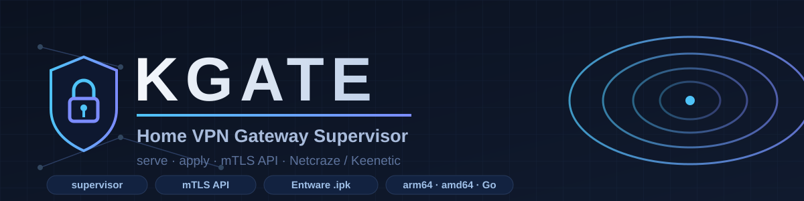
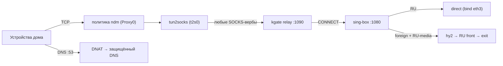

<div align="center">



**KGATE** — единая утилита для VPN-стека на роутерах **Netcraze / Keenetic**:
демон-супервизор на роутере + mTLS-клиент + деплойер «с нуля до рабочего состояния».

[](https://github.com/Korrnals/kgate/releases)
[](#поддерживаемые-роутеры)
[](#артефакты)
[](docs/api/authentication.md)
[](#-документация)

`kgate serve` · `kgate deploy` · `kgate config create` · `kgate status` · `kgate destroy` · `kgate ruexit on`

</div>

---

## 📋 Требования и совместимость — подходит ли мне?

| Что | Требование |
|---|---|
| Роутер | **Netcraze / Keenetic**, архитектура **aarch64** (MIPS/legacy KN — нет) |
| ОС | KeeneticOS / NetcrazeOS **4.x–5.x** + Entware в `/opt` (проверено: 5.01.C.7.0-4, Netcraze Ultra) |
| Место | **≥ 120 МБ** свободного под стек (рекомендуется USB; встроенная память Ultra — впритык) |
| Ноутбук | Linux amd64/arm64 + ssh-ключ до роутера (ssh-бинарник **не нужен** — транспорт на Go) |
| Туннель | **hysteria2** (± obfs salamander) до **своего/предоставленного** сервера (sing-box/hysteria2, TLS на домен); пароль, не подписки |
| Локально | SOCKS5 `:1080`/`1090`, redirect `:1081`; RU-сплит (geosite/geoip в комплекте); тумблер Proxy0 + per-device политики |

**Нет из коробки:** подписки (subscription-URL), другие протоколы (vless/trojan/ss/wg — движок умеет, kgate не конфигурирует), режим сервера, нативная карточка в веб-UI.

Полная матрица и self-check — [docs/admin/requirements.md](docs/admin/requirements.md).

---

## ⚡ Быстрый старт

Ноутбук оператора — три команды и один редактор:

```bash
curl -fsSL https://raw.githubusercontent.com/Korrnals/kgate/main/scripts/install.sh | sh
kgate config create      # шаблон конфига + редактор ($VISUAL/$EDITOR)
kgate deploy             # стек на роутер: бинари, конфиги, ndm-правила, сервис
```

> [!NOTE]
> Репозиторий и релизы публичные — токены не нужны. Инсталлер кладёт CLI в
> `~/.local/bin`; `config create` — `~/.kgate/kgate.yaml` и печатает путь.

Пошагово — [docs/admin/install.md](docs/admin/install.md). Другие пути
(opkg-фид на роутер, из исходников) —
[docs/admin/alternatives-install.md](docs/admin/alternatives-install.md);
подготовка роутера и носителя — [docs/admin/preparation.md](docs/admin/preparation.md).

---

## 📚 Документация · дерево навигации

```
docs/
├── 🏗 architecture/                 — как это устроено
│   ├── overview.md                  — назначение, роли бинаря, принципы
│   ├── components.md                — компоненты, схемы демона, интеграция с ndm
│   ├── data-flow.md                 — потоки трафика и сценариев (ON / OFF / RU-exit)
│   └── data-model.md                — конфиг-модель, payload, объекты API
│
├── 🛠 admin/                        — администрирование
│   ├── preparation.md               — 🧰 подготовка роутера и носителя Entware
│   ├── install.md                   — установка: фид / вручную / деплойер
│   ├── configuration.md             — kgate.yaml + критичные поля sing-box
│   ├── segments-and-policies.md     — ⚠️ сегменты ndm: грабли №1
│   ├── operations.md                — эксплуатация и диагностика
│   ├── releases.md                  — обновление, откат, верификация подписей
│   ├── opkg-feed.md                 — 📦 opkg-фид: подключение и публикация
│   └── uninstall.md                 — 🔴 удаление и очищение
│
├── 👤 user/                         — пользователю
│   ├── getting-started.md           — начало работы
│   ├── day-to-day.md                — повседневное управление
│   ├── ru-exit.md                   — 🕶 RU-анонимизация
│   └── faq.md                       — частые вопросы
│
├── 🔌 api/                          — интеграция
│   ├── authentication.md            — mTLS, сертификаты, конвенции
│   ├── endpoints.md                 — карта эндпоинтов, легенда методов
│   ├── endpoints-status-verify.md   — 🟢 status · verify
│   ├── endpoints-toggle.md          — 🔵 toggle (тумблер VPN)
│   ├── endpoints-ruexit.md          — 🔵 ruexit (RU-exit)
│   └── endpoints-logs-reboot.md     — 🟢 logs · 🔴 reboot
│
└── 📖 glossary.md                   — глоссарий терминов
```

| Хочу… | Открой |
|---|---|
| понять, как устроено | [architecture/overview](docs/architecture/overview.md) → [components](docs/architecture/components.md) |
| подготовить роутер к установке | [admin/preparation](docs/admin/preparation.md) |
| проверить, подходит ли моё железо/сервер | [admin/requirements](docs/admin/requirements.md) |
| установить/обновить | [admin/install](docs/admin/install.md) → [admin/releases](docs/admin/releases.md) |
| настроить конфиги | [admin/configuration](docs/admin/configuration.md) |
| разобраться, «почему трафик прямой» | [admin/segments-and-policies](docs/admin/segments-and-policies.md) |
| включить RU-анонимизацию | [user/ru-exit](docs/user/ru-exit.md) |
| интегрироваться по API | [api/authentication](docs/api/authentication.md) → [карта эндпоинтов](docs/api/endpoints.md) |
| свериться с терминами | [glossary](docs/glossary.md) |
| удалить всё | [admin/uninstall](docs/admin/uninstall.md) |

---

## Что это

Один статический Go-бинарь, три роли:

| Роль | Команда | Где | Ответственность |
|---|---|---|---|
| 🧠 **Демон** | `kgate serve` | роутер (Entware, init-скрипт) | супервизор sing-box, DNS-правила, авто-подъём туннеля, толерантный SOCKS-relay для ndm, mTLS API |
| 🎛 **Клиент** | `kgate status / verify / toggle / ruexit / logs / reboot` | ноутбук | управление и диагностика через mTLS |
| 🚀 **Деплойер** | `kgate deploy` / `kgate destroy` | ноутбук, по ssh (чистый Go-транспорт, без ssh-бинарника) | установка/снятие стека, идемпотентные стадии; подтверждение на дестрое |

## Архитектура (кратко)



Подробные схемы и описания — [docs/architecture/](docs/architecture/overview.md).

## Поддерживаемые роутеры

**Netcraze / Keenetic** (ndm OS 4.x–5.x, Entware, aarch64). Интеграция с ndm —
суть утилиты: тумблер Proxy0, route-pins, сегменты/политики, переживание
пересборок netfilter. Порт на другие платформы — через адаптеры (roadmap).

## Сборка

```bash
make build             # payload (sing-box + kgate arm64) + хостовый CLI
make release-binaries  # релизные бинари в dist/
make ipk               # Entware .ipk
make install-cli       # CLI в ~/.local/bin
```

## 🗂 Структура репозитория

```
├── internal/                  — исходники Go (демон, клиент, деплойер, конфиг)
├── main.go                    — единая точка входа (serve + client + deployer)
├── scripts/
│   ├── build-ipk.sh           — сборка самодостаточного Entware .ipk
│   ├── build-feed.sh          — индекс opkg-фида (Packages / Packages.gz)
│   └── install.sh             — one-liner установка CLI с ноутбука
├── examples/                  — вендоренные материалы для пакета:
│   ├── S99kgate               — init-скрипт демона
│   ├── ndm-commands.sh        — ndm-конфигурация (Proxy0, pins, DNS, политики)
│   ├── kgate.yaml.example     — шаблон kgate.yaml
│   └── etc/sing-box/          — config.json + rulesets/*.srs (входят в ipk)
├── docs/                      — документация (дерево выше)
├── local/                     — реальные материалы стека (gitignored)
└── dist/, build/              — артефакты сборки
```

Легаси-каталога `deploy/` больше нет: единственный источник init- и
ndm-скриптов — `examples/` (проверяется на этапе сборки ipk).

## Безопасность

- mTLS: клиентский сертификат обязателен; ключи сервера — только на роутере
- API не экспонируется в интернет (LAN + файрвол)
- секреты стека не входят в репозиторий: `examples/` — шаблоны, `local/` — реальные (gitignored)
- деплой — по ssh ключом, BatchMode; интерактивных паролей нет

## Roadmap

- [ ] адаптеры платформ: OpenWrt (nftables/uci)
- [ ] веб-мини-панель демона
