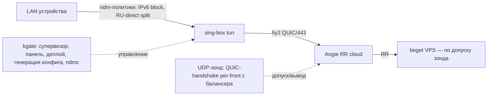
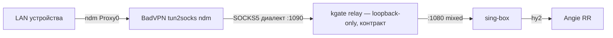

# 0001. Использовать sing-box tun как единый data-path роутера

- Статус: Accepted
- Дата: 2026-11-16
- Решающие: Tech Lead (председатель), Product Architect, Senior Security Engineer, Senior System Engineer
- Принятие: консенсус Архитектурного комитета 2026-11-16 — три специалиста из трёх плюс председатель

## Контекст

Решение отвечает на директиву владельца от 2026-11-16: «задолбали качели — нужно нормальное, качественное решение; если надо — разрабатывать». Фактура: три регрессии рукописного SOCKS5-релея за четыре дня. kgate-001 — лавина из 143 тысяч попыток `dial tcp 0.0.0.0:0`: отказ класса CWE-400 (неограниченное потребление ресурсов), фактически отказ в обслуживании всей домашней сети при 1 ГБ ОЗУ. kgate-003 — смерть всех UDP-ассоциаций (UDP — User Datagram Protocol) за 1–2 секунды. kgate-004 — в работе; гипотеза корня: время жизни UDP-ассоциации якорится к управляющему TCP-соединению (control-conn), и его закрытие клиентом гасит UDP-сокет. Общий корень всех трёх регрессий: data-path (пакетный путь трафика от устройств локальной сети в туннель) не покрыт лабораторной матрицей вовсе — единственный компонент на границе доверия остался без внешней обкатки и без собственных тестов.

Второй вопрос повестки — допуск UDP-апстримов балансировщика. Хостер beget дважды за два дня впадал в состояние «чёрной дыры» для UDP, а пассивная проверка Angie этого не видит: проверка по TCP не замечает смерть UDP-ноги, и балансировщик round-robin (RR — циклическое распределение нагрузки) продолжает отправлять трафик в мёртвый апстрим.

Ограничения платформы проверены живым зондированием прошивки 2026-11-16: ядро 4.9-ndm-5 собрано без TPROXY (transparent proxy — механизм ядра Linux для прозрачного перехвата трафика) и без nftables; среди 149 доступных модулей ядра нужных нет; узел `/dev/net/tun` присутствует. Entware (репозиторий пользовательских пакетов прошивки) kernel-модули не доставляет; утилиты `ip rule`/`ip route` урезаны в busybox; UDP REDIRECT теряет адрес оригинального получателя — перенаправление работает только для TCP. Прошивка ndm переутверждает таблицу маршрутизации при каждом событии на внешнем интерфейсе (WAN — wide area network, внешнее сетевое подключение роутера).

Действующий путь трафика: ndm-политика Proxy0 → BadVPN tun2socks (штатный компонент прошивки; SOCKS-клиент говорит нестандартным диалектом — UDP ASSOCIATE с нулевой целью) → рукописный релей на порту 1090 → sing-box (mixed, порт 1080) → туннель hy2 (Hysteria2; QUIC — Quick UDP Internet Connections, транспортный протокол поверх UDP) до балансировщика Angie. Рукописный релей существует по одной причине: он единственный участник, говорящий на диалекте BadVPN. Захват tun уже используется в рабочей среде (BadVPN держит tun-интерфейс под ndm-политикой), поэтому миграция меняет потребителя tun, а не добавляет второй оверлей.

## Решение

Принято консенсусом комитета от 2026-11-16.

1. **Целевой data-path роутера — sing-box в режиме tun.** Собственный пакетный data-plane в kgate не пишется.
2. **Рукописный SOCKS5-релей — объявленный мост с датой сноса.** В фазе S релей доводится до проверяемого контракта; в фазе L код релея удаляется. Настоящий ADR фиксирует снос релея как обязательный шаг фазы L.
3. **kgate — управляющий контур, а не data-plane.** Супервизор, панель на mTLS (mutual TLS — взаимная аутентификация по сертификатам обеих сторон), деплой, генерация конфигурации; унаследованные от ndm обязанности (закрепление маршрутов, DNS-правила, kill-switch — аварийная блокировка трафика при отказе туннеля) исполняются через ndmc (интерфейс командной строки прошивки).
4. **Допуск UDP-апстримов — активная проба уровня приложения на балансировочной ноде.** QUIC-рукопожатие к каждому фронту с гистерезисом, возвратом после испытания под нагрузкой (soak) и гвардом последнего живого апстрима. Единственный авторитет допуска — балансировщик: он измеряет именно свою RR-ногу и переживает перезагрузки роутера; роутер — наблюдатель. Ручной инвентарный флаг — только break-glass (аварийное ручное вмешательство).
5. **Критерий убийства направления:** провал спайка tun в фазе M — эскалация к владельцу (per-device явный прокси для UDP-критичных устройств либо ревизия ограничений прошивки), но не возврат к закалке релея.

### Целевой контур (фаза L)

### Действующий мост (фаза S)

### Фазы и гейты

| Фаза | Содержание | Гейт перехода |
|---|---|---|
| S — мост (сложность M, дни) | Довести релей до контракта: семантика UDP-ассоциации (переживает закрытие control-conn с grace-окном — льготным интервалом — и таймаутом простоя); матрица диалекта BadVPN в лаборатории до фикса kgate-004; привязка релея только к loopback-интерфейсу (127.0.0.1); canary (канареечный выкат) и UDP-смоук-тест в деплоере; телеметрия в `kgate status` | 48 часов soak в рабочей среде; ноль сигнатуры `dial tcp 0.0.0.0:0`; живучесть ассоциаций более 10 минут; откат отрепетирован |
| M — спайк tun и автоматика допуска (сложность L, 1–2 недели) | Спайк tun на устройстве: DNS-петля, WAN-флап с переутверждением ndm, семантика kill-switch и резервного канала (ISP-backup), RAM/CPU под нагрузкой, тест G4 — при остановке sing-box трафик блокируется (fail-closed), дамп внешнего интерфейса обязан остаться пустым. Автоматика допуска: watchdog v1 (сторож) с per-фронтовыми QUIC-пробами; выброс апстрима после 2–3 неудач подряд; возврат после ≥24 часов soak и решения Tech Lead; эскалации 30 → 7 дней → владельцу; гвард последнего живого апстрима; статус CRITICAL при отказе обоих апстримов | Все пробы зелёные на устройстве; 7 дней canary-сегмента на tun |
| L — миграция и снос (сложность M, 2–4 недели) | Посегментная миграция семьи на tun; удаление кода релея (дата сноса — здесь); ревизия ndm-объектов (Proxy0, закрепление маршрутов, DNS-правила — всё, что tun не покрывает); обновление ADR и руководств | 14 дней без регрессий; релей удалён; руководства обновлены |

Текущее состояние моста: роутер работает на откате 001dev (с 2026-11-16, 10:54 UTC) — UDP идёт через старый код релея; бинарник kgate-004 заменит его после прохождения гейта фазы S.

## Последствия

### Положительные

- Граница доверия уходит из рукописного кода: пакетный путь обслуживает sing-box с многолетней внешней обкаткой.
- Класс отказов kgate-001/003/004 устраняется удалением компонента, а не бесконечной закалкой.
- kgate возвращается к ратифицированной ценности — управляющему контуру; конфиг-схема роутера сходится с клиентской линией orvex.
- Допуск UDP-апстримов становится измеримым и автоматическим: балансировщик видит смерть UDP-ноги за минуты, а не за дни.

### Нейтральные

- ADR-0004 «keenetic-singbox» (репозиторий hysteria) сужается до прецедента направления: настоящий ADR фиксирует конкретную цель и фазы.
- Спор «kgate тонкий или нет» закрыт: вес управляющего контура признан — супервизор наследует обязанности ndm через ndmc.

### Отрицательные: принятые остаточные риски

| Риск | Митигация | Почему принимается |
|---|---|---|
| Fail-open (при отказе трафик уходит напрямую с домашним IP) при дрейфе ndm-конфигурации: правила и маршруты слетают на WAN-событиях | Внешний периодический leak-зонд (проверка exit-IP) и телеметрия | На этой платформе не устраняется полностью; риск общий для обеих фаз |
| Единственный процесс data-plane (sing-box) | Перезапуск супервизором, зонд доступности, fail-closed по тесту G4 | Нетто-риск ниже текущего: минус рукописный хоп |
| Kernel-DoS (отказ в обслуживании на уровне ядра) от гостевого устройства | hashlimit и лимиты соединений в правилах | 1 ГБ ОЗУ; полу-доверенная локальная сеть |
| Потолок пропускной способности tun на ARM-классе (оценка 50–80 Мбит/с, требует замера) | Фиксация фактической цифры в лабораторной матрице | Для семейного сценария приемлемо |
| Зонд с балансировщика не видит ногу роутер→Angie | Самодиагностика hy2-клиента kgate и health-порты | Атрибуция RR-ноги важнее полноты обзора |
| Зондовые рукопожатия видны хостеру | Джиттер интервалов; неотличимы от клиентского трафика | Дешевле слепоты пассивной проверки |

## Рассмотренные альтернативы

| Альтернатива | Суть | Причина отказа |
|---|---|---|
| (a) Довести релей до паритета и оставить навсегда | Закалка рукописного SOCKS5-UDP до промышленного качества | Отвергнуто как целевая архитектура: три регрессии за четыре дня — свойство класса компонента (NAT-таблица — Network Address Translation, жизненный цикл ассоциаций, обработка гонок); доведение до паритета — месяцы переизобретения бинарника, который уже стоит на коробке. Допустимо строго как мост фазы S с датой сноса |
| (b) TPROXY как data-path | Прозрачный перехват трафика модулем ядра | Физически недоступно: ядро 4.9-ndm-5 собрано без TPROXY и nftables (закрыто живым зондированием 2026-11-16); Entware kernel-модули не доставляет |
| (e) Гибрид tproxy + релей | TPROXY для TCP, релей для UDP | Отклонено по тем же причинам ядра; дополнительно UDP REDIRECT теряет адрес оригинального получателя (перенаправление — только TCP). Физически недоступно |
| (d) Per-device явный SOCKS5-прокси | Настройка прокси отдельно на каждом устройстве семьи | Отвергнуто: fail-open по конструкции — при смерти пути трафик тихо уходит напрямую с домашним IP (утечка); дрейф конфигураций на многих устройствах; семья как целое не покрывается. Допустимо только как диагностическая полоса |
| (f) Новый рукописный data-plane | Своя реализация пакетного пути взамен релея | Отвергнуто: воспроизводит класс отказов релея; соответствие протоколу (conformance) домашнего проекта не догоняет многолетнюю обкатку sing-box; встраивание libbox — линия orvex, а не роутера |
| Активные UDP-проверки средствами Angie | Active health checks в самом балансировщике | Отложено: в открытом пакете Angie активные UDP-проверки отсутствуют (ADR-0033, репозиторий hysteria; кандидат этапа 2). Пересмотреть при появлении в апстриме |

## Ссылки

- Протокол комитета: файл `2026-11-16-router-tunnel-data-path.md` (team-local, в репозитории не хранится).
- Архитектурный контракт: файл `2026-11-16-router-tunnel-data-path-contract.md` (team-local, в репозитории не хранится).
- Vesma-запись решения: id `f9e1dc0a` (project:hysteria, тег committee) — краткая каноническая формулировка.
- ADR-0004 «keenetic-singbox» и ADR-0033 «ru-front-2-angie-l4-balancer» — репозиторий hysteria, каталог `docs/08-decisions/`.
- kgate-004 — карточка задачи в командном трекере; HYST-050 — задача UDP-зонда балансировщика.
