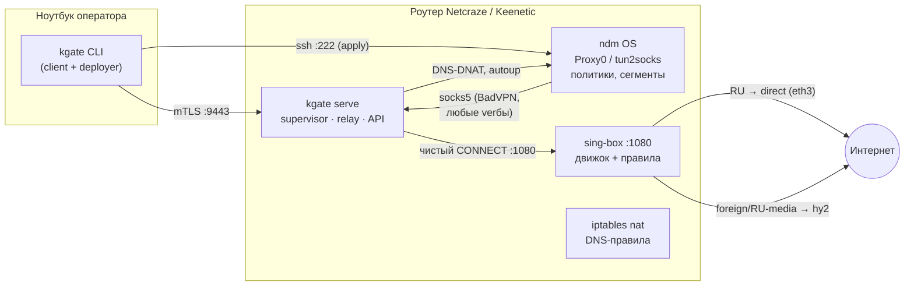

# Архитектура · Компоненты

## Карта компонентов

## Демон `kgate serve`

Внутренние подсистемы и их ответственность:

| Подсистема | Тик/триггер | Поведение |
|---|---|---|
| **Process manager** | 15 с | sing-box жив? → рестарт с бэкоффом (5→30 с), `RLIMIT_NOFILE` наследуется; reaper собирает статусы (зомби не влияют на `alive`) |
| **DNS-rules keeper** | 15 с | jump `SBREDIRECT` в nat PREROUTING на месте? нет → переприменить (ndm сносит nat при любом событии интерфейса) |
| **Tunnel auto-raise** | раз при старте | дождаться `:1080` → `ndmc interface Proxy0 up` (без бут-гонки ndm↔Entware) |
| **SOCKS relay** | постоянно | `127.0.0.1:1090`: принимает любые SOCKS-вербы ndm-клиента (включая «command 5»), отвечает успехом, транслирует в CONNECT к sing-box `:1080` |
| **mTLS API** | постоянно | `:9443`, RequireAndVerifyClientCert; эндпоинты status/verify/toggle/ruexit/logs/reboot |

Детерминированное окружение (`daemonEnv`): демон принудительно задаёт `PATH`,
`HOME`, `TERM` для всех shell-вызовов — бут-минимум rc.unslung не влияет.

## Точки интеграции с ndm

| Точка | Механика | Зачем |
|---|---|---|
| Proxy0 (up/down) | `ndmc -c "interface Proxy0 up\|down"` | тумблер VPN: primary :800 в дефолтной политике, ISP :700 — backup |
| route-pins | `ip route <ip> ISP` | hy2-сервер и DNS-сервер не должны попадать в туннельную политику (петли) |
| tun2socks | ndm-компонент, интерфейс `t2s0` | ndm сам заворачивает помеченный трафик в SOCKS — на наш relay |
| nat пересборки | `InterfaceFlusher` | любое событие интерфейса сносит пользовательские chains — демон восстанавливает |

## Adapters (задел на универсальность)

Вся работа с платформой изолирована в трёх интерфейсных точках:
`tunnelToggle(on/off)`, `dnsRules(apply/check)`, `tunnelHealth()`.
Сегодня реализован ndm-адаптер; порт на OpenWrt = реализация тех же точек
через uci/nftables — код демона, relay и API не меняются.

См. также: [data-flow.md](data-flow.md) — потоки, [data-model.md](data-model.md) — конфиг и объекты.
