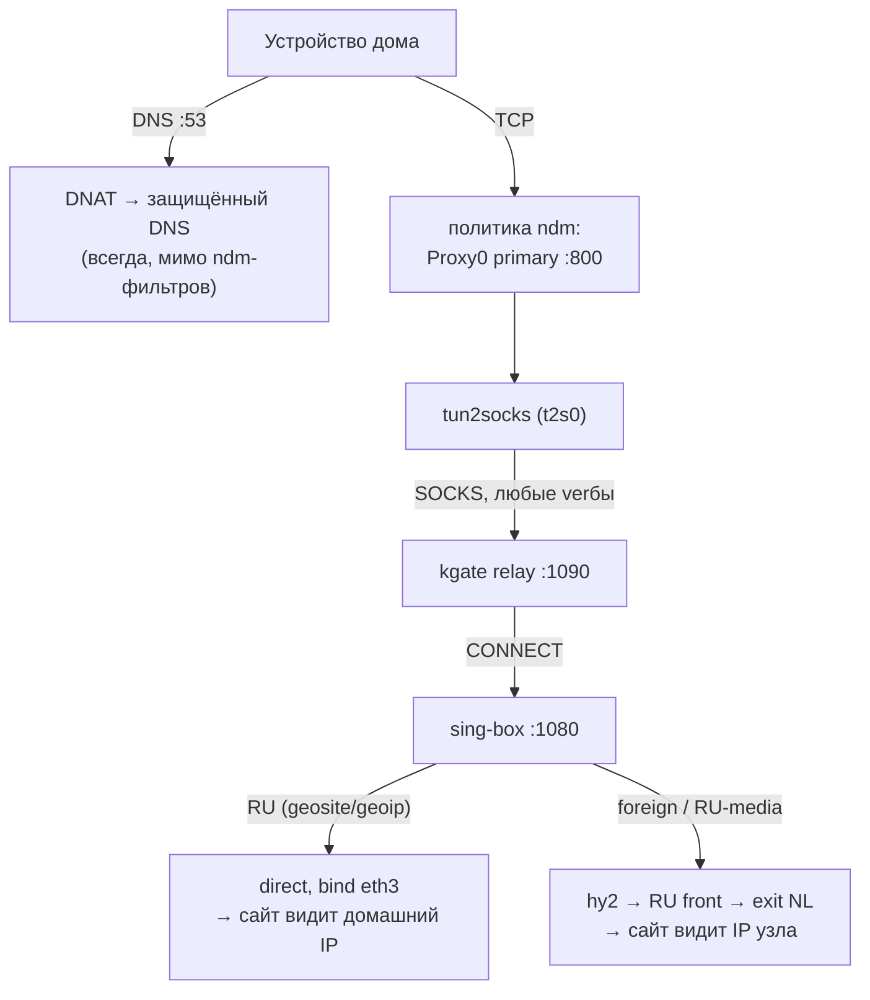
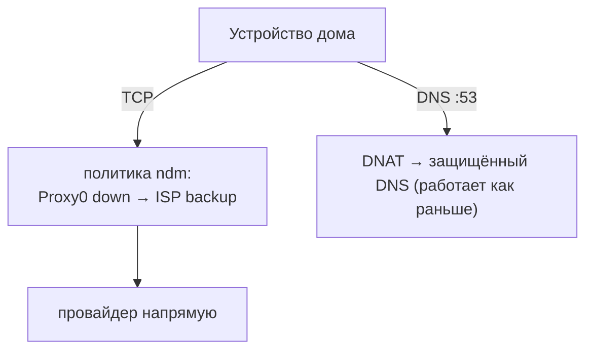
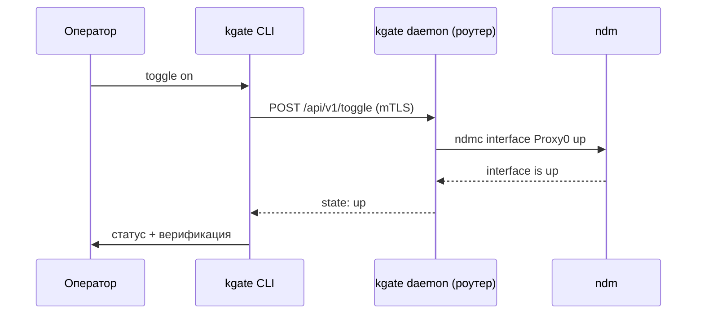

# Архитектура · Потоки данных

## Поток при тумблере ON (штатный режим)



- TCP устройства помечается политикой ndm → tun2socks → relay → sing-box.
- sing-box классифицирует: локальные сети и RU — напрямую (`bind eth3`,
  чтобы не зациклиться в политике), зарубежное и заблокированные RU-медиа —
  через выходной туннель.
- DNS устройств всегда уходит на защищённый резолвер мимо ndm-фильтров и
  DNS-подавления провайдера — независимо от положения тумблера.

## Поток при тумблере OFF



- ndm сам переводит политику на backup-подключение: туннель и relay не участвуют.
- RU-ресурсы работают; зарубежные — в соответствии с ограничениями провайдера.

## Поток тумблер-команды (`kgate toggle`)



## Поток деплоя (`kgate apply`)

```mermaid
sequenceDiagram
    participant A as Администратор
    participant C as kgate (deployer)
    participant R as Роутер
    A->>C: apply -c kgate.yaml
    C->>R: preflight (Entware, uptime)
    C->>R: payload.tar.gz (kgate arm64, sing-box, конфиги, скрипты)
    C->>R: opkg install; раскладка файлов; миграция legacy
    C->>R: рендер kgate.yaml + mTLS-сертификаты
    C->>R: ndm-команды (Proxy0, route-pins, DNS, политики)
    C->>R: S99kgate start
    C->>A: verify (mTLS) + локальный socks-тест
```

Payload — самодостаточный tar: `kgate-arm64`, `sing-box` (pinned static),
`S99kgate`, `ndm-commands.sh`, `root/opt/etc/...` (конфиги из `local/etc` или
шаблоны `examples/etc`).

## Инварианты

- DNS устройств ходит через защищённый резолвер при любом состоянии тумблера.
- Выходной туннель (hy2) и DNS sing-box никогда не попадают в туннельную
  политику — за это отвечают route-pins (`/32 → ISP`).
- `direct`-outbound sing-box привязан к физическому WAN (`bind_interface`),
  иначе RU-трафик ловится политикой и зацикливается в tun2socks.
